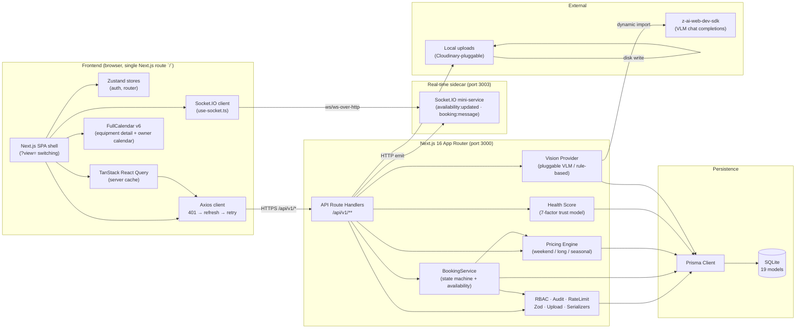
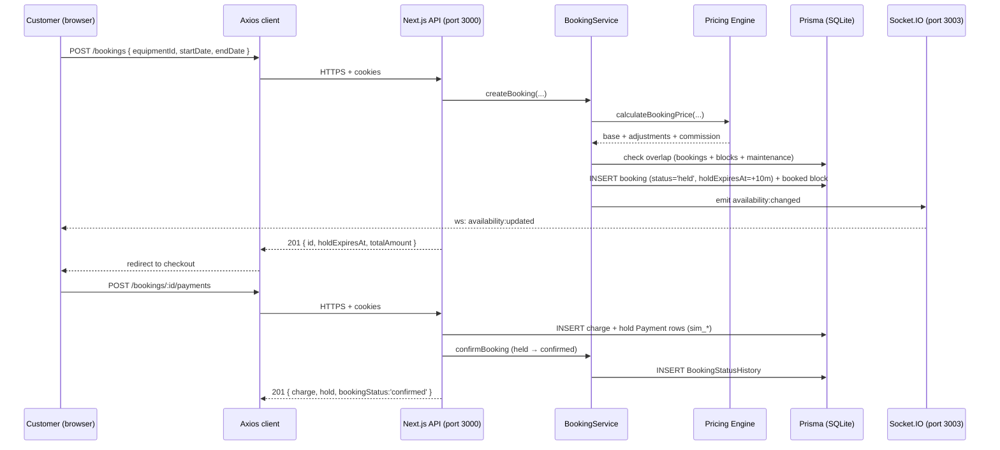

# RentalHub — Architecture

**RentalHub** is an equipment rental marketplace built on a single-process Next.js 16 stack with a
thin real-time sidecar. The frontend is a single-page application (one Next.js route, `?view=`
switching) that talks exclusively to a versioned REST API (`/api/v1/*`). A small Socket.IO
mini-service runs on port 3003 for live availability + booking chat. Persistence is Prisma + SQLite
(19 models). External AI is consumed through a pluggable **Vision Provider** interface backed by
the `z-ai-web-dev-sdk` (VLM) with a rule-based fallback; file uploads land in a local folder behind
a Cloudinary-pluggable interface.

This document is the architectural companion to [`API_CONTRACT.md`](./API_CONTRACT.md),
[`ER.md`](./ER.md), [`PROGRESS.md`](./PROGRESS.md), and [`DECISIONS.md`](./DECISIONS.md).

---

## 1. High-level diagram

---

## 2. Component descriptions

### 2.1 Frontend (browser)

The browser runs a **single Next.js page** (`src/app/page.tsx`) that renders a shell and switches
views with a `?view=<key>` query param (client-side routing via `src/store/router.ts`). All UI is
shadcn/ui (New York) + Tailwind CSS 4 + Framer Motion; `next-themes` provides dark mode.

| Component | Role |
| --- | --- |
| **Next.js SPA shell** | The only user-visible route. Renders the active view based on `?view=`. 30+ views are mapped across home, search, equipment detail, checkout, booking detail, owner dashboards, admin consoles, analytics, fraud, disputes, pricing suggestions, etc. (see `PROGRESS.md → Page Inventory`). |
| **Axios client** (`src/lib/api-client.ts`) | The single HTTP entrypoint. Intercepts `401 UNAUTHENTICATED`, transparently POSTs to `/api/v1/auth/refresh` (same-site cookies), rotates the refresh cookie, and **retries the original request once**. On a second `401` it logs the user out via the Zustand auth store. |
| **Zustand stores** (`src/store/auth.ts`, `src/store/router.ts`) | Lightweight client state: the authenticated user, the active `?view=` key. Replaces the spec's Redux Toolkit. |
| **TanStack React Query** | Server-state cache for all `GET` endpoints. Powers every list/detail view with stale-while-revalidate, background refetch, and optimistic invalidation on mutation. |
| **FullCalendar v6** (`@fullcalendar/react` + day-grid + interaction) | Mounted on the equipment detail page (date-range select → checkout) and the owner master calendar (multi-equipment bookings across the owner's listings). |
| **Socket.IO client** (`socket.io-client` via `src/hooks/use-socket.ts`) | `useAvailabilityUpdates(equipmentId)` subscribes to the `availability:updated` event for live calendar refresh; `useBookingChatSocket(bookingId)` subscribes to `booking:message`. Both fall back to 30 s polling if the sidecar is down. |

### 2.2 Backend (Next.js 16 App Router, port 3000)

All server logic is implemented as **Route Handlers** under `src/app/api/v1/**/route.ts`. They share
a single envelope (`{ success, data, error, meta }`), a single error-code table, and a thin
`apiHandler` wrapper that maps Prisma `P2002`/`P2025` to `CONFLICT 409`/`NOT_FOUND 404` and runs the
in-memory rate limiter.

| Component | Role |
| --- | --- |
| **API Route Handlers** (`/api/v1/**`) | ~70 endpoints across Auth, Categories, Equipment, Availability, Maintenance, Reviews, Wishlist, Upload, Admin, Bookings, Disputes, Cron, Analytics, Intelligence, Bundles, Waitlist, Search, Health, GDPR. Each route delegates to one or more of the services below. |
| **BookingService** (`src/lib/booking-service.ts`) | The rental lifecycle engine. Owns the booking state machine (`pending → held → confirmed → picked_up → in_use → return_pending → returned → inspected → completed`, with `cancelled`/`late`/`disputed` branches), overlap validation against bookings + availability blocks + maintenance windows, buffer-time handling, 10-minute checkout hold, pricing via the Pricing Engine, deposit + commission, cancellation refunds (flexible/moderate/strict), idempotency keys, extension requests, and expired-hold release. Every legal transition writes a `BookingStatusHistory` row. |
| **Vision Provider** (`src/lib/vision-provider.ts`) | Pluggable interface (`VisionProvider.compare(pickupUrl, returnUrl, angle) → ComparisonResult`). Two implementations: **`VLMProvider`** dynamically imports `z-ai-web-dev-sdk` and runs a chat completion with a damage-assessment prompt; **`RuleBasedProvider`** is the always-on fallback that returns a "no significant changes" finding with confidence 0.6. Both return `{ findings[], providerUsed, promptLog (redacted), summary }`. Selection is via `getVisionProvider()`. |
| **Pricing Engine** (`src/lib/pricing.ts`) | `calculatePrice()` applies up to 8 dynamic rules per listing: `weekend_surcharge`, `long_discount`, `seasonal` (with `start`/`end`), in `percent` or `amount` units. `BookingService.calculateBookingPrice()` adds a flat 10% platform commission and computes the deposit. `POST /intelligence/what-if` reuses the engine to project simulated revenue at a different daily price. |
| **Health Score** (`src/lib/health-score.ts` + endpoint) | Two layers: a **per-user Trust Score** computed live from 7 weighted factors (Verification 10, Completed rentals 25, Cancellation rate 15, Punctuality 20, Disputes 10, Reviews received 10, Avg rating 10 = 100), stored on `User.trustScore` and nudged by `±(rating-3)×2` on each review; and a **platform Health endpoint** (`GET /health`) that reports DB connectivity + latency, row counts, uptime, and version. The same 7-factor model feeds `late-prediction` (trust×0.4 + time-to-end×0.6) and the `low_trust_score` fraud rule. |
| **Shared libraries** (`src/lib/*`) | `rbac.ts` (`requireAuth`, `assertOwner`, `optionalAuth`), `auth.ts` (hand-rolled HS256 JWT in httpOnly cookies with rotating refresh), `audit.ts` (writes `AuditLog` rows), `rateLimit.ts` (per-IP+route token bucket, Redis-pluggable), `validators.ts` (Zod schemas), `upload.ts` (multipart validator + disk writer, Cloudinary-pluggable), `serializers.ts` (`SafeUser`, `equipmentInclude`), `db.ts` (Prisma singleton), `geo.ts` (Haversine), `api.ts` (`ok`/`paged`/`fail`/`failFromZod` + `HttpError`), `handler.ts` (`apiHandler` + `getParams`). |

### 2.3 Database (Prisma + SQLite, 19 models)

The database is a single SQLite file (`db/custom.db`) accessed through Prisma. IDs are CUIDs.
Enums are stored as `String` and validated by Zod at the API boundary (SQLite has no native enum
type). Soft delete is implemented as a nullable `deletedAt` column on `User`, `Category`,
`Equipment`, and `Review`; every read path filters `deletedAt: null`.

The 19 models (full schema in [`ER.md`](./ER.md) and `prisma/schema.prisma`):

| # | Phase | Model |
| --- | --- | --- |
| 1  | 1 | `User` — 3 roles (`customer`/`owner`/`admin`), trust score, accountType/business fields |
| 2  | 1 | `Category` — slug-based, optional parent |
| 3  | 1 | `Equipment` — listing, JSON `pricingRules`, geo (lat/lng), condition, status |
| 4  | 1 | `EquipmentImage` — ordered, one isPrimary |
| 5  | 1 | `EquipmentSpec` — ordered key/value |
| 6  | 1 | `AvailabilityBlock` — `owner_blocked` / `maintenance` / `booked` |
| 7  | 1 | `MaintenanceLog` — title/description/cost/performedAt |
| 8  | 1 | `MaintenanceWindow` — date range, auto-creates a `maintenance` block |
| 9  | 1 | `Wishlist` — customer ↔ equipment |
| 10 | 1 | `Review` — reviewer + receiver + optional equipment, 1–5 stars |
| 11 | 1 | `ReviewHelpfulVote` — helpful-vote toggle |
| 12 | 1 | `Notification` — in-app bell + `x-unread-count` header |
| 13 | 1 | `AuditLog` — action/resource/actor/target/metadata JSON |
| 14 | 2 | `Booking` — full state-machine fields, JSON checklists + photos, idempotency |
| 15 | 2 | `BookingStatusHistory` — append-only transition audit |
| 16 | 2 | `Payment` — `hold` / `release` / `refund` / `charge` / `commission`, simulated gateway |
| 17 | 2 | `BookingMessage` — customer ↔ owner chat |
| 18 | 2 | `Dispute` + `DisputeMessage` — reason, status, resolution, isStaff flag |
| 19 | 3 | `PriceSuggestion` — persisted AI pricing suggestion (accept/dismiss/edit) |
| 20 | 4 | `DamageComparison` — pickup/return URLs, findings JSON, `pending`/`confirmed`/`rejected` |
| 21 | 4 | `Bundle` — smart bundle (≥2 items, discount 0–50%) |
| 22 | 4 | `BundleItem` — bundle ↔ equipment, `required` flag |
| 23 | 4 | `Waitlist` — date range, `waiting`/`notified`/`booked`/`expired` |

> The "19 models" headline counts the Phase 1–4 entity tables. `Dispute` + `DisputeMessage` are
> sometimes presented as one "disputes" pair; the exact count varies by how child/junction tables
> are grouped. The full set is enumerated above so the schema is unambiguous.

### 2.4 Real-time sidecar (Socket.IO on port 3003)

A standalone Node service (`mini-services/availability-socket/index.ts`) listens on **port 3003**.
The Next.js API routes emit to it over HTTP (`socket.emit('availability:changed', …)`) when a booking
or availability block is created/removed; the sidecar then broadcasts `availability:updated` to every
client that has joined the per-equipment room (`watch:equipment` / `unwatch:equipment`). It also
relays `booking:message` events between the two parties in a booking chat room
(`join:booking` / `booking:message`). The frontend `use-socket.ts` hook connects to it; if the
sidecar is unreachable, the SPA falls back to 30 s polling. The sidecar keeps no persistent state —
it is purely a pub/sub fanout.

### 2.5 External integrations

| Integration | How it's used | Pluggability |
| --- | --- | --- |
| **`z-ai-web-dev-sdk` (VLM)** | Consumed by `VLMProvider.compare()` for AI damage detection between pickup and return photos. A chat completion is sent with a damage-assessment system prompt + a structured user prompt asking for `{ findings: [{ region, severity, description, confidence }] }`. | **Pluggable.** The Vision Provider interface lets you swap VLM for any other multimodal LLM or a perceptual-hash rule-based comparator. `getVisionProvider()` returns the VLM provider; if the SDK is missing or throws, it transparently falls back to `RuleBasedProvider`. |
| **File uploads (Cloudinary-pluggable)** | `src/lib/upload.ts` validates type/size/count and writes to `public/uploads/`. Each upload returns `{ url, publicId }`; `DELETE /upload` removes by `publicId`. | **Pluggable.** Three functions (`parseAndSaveImages`, `deleteImage`, `buildPublicId`) are the seam; replacing them with Cloudinary / S3 changes nothing else. |
| **Email** | Forgot/reset password tokens are printed to the dev console (no SMTP in sandbox). | **Pluggable.** Swap the mailer behind the same `sendResetEmail()` signature. |
| **Payments** | `POST /bookings/:id/payments` writes `charge` + `hold` `Payment` rows with `status:'completed'` and a `sim_*` reference. | **Pluggable.** Stripe/Razorpay can be wired behind the same `Payment` interface. |
| **Rate limiter** | In-memory per-IP+route token bucket. | **Pluggable.** Same `rateLimit()` signature, swap to Redis for multi-server. |

---

## 3. Request lifecycle (happy path)

A booking checkout illustrates how the components interact:

---

## 4. Failure / fallback paths

- **Access token expired** → Axios `401` interceptor → `POST /auth/refresh` (rotates the refresh
  cookie) → retry the original request once → second `401` logs the user out.
- **VLM unavailable** → `VLMProvider` catches the import/call failure and delegates to
  `RuleBasedProvider`, so damage comparison always returns a (preliminary) result with a disclaimer.
- **Socket.IO sidecar down** → `use-socket.ts` falls back to 30 s polling for availability; chat
  messages are still delivered on the next manual refresh.
- **Cron not scheduled** → `POST /cron/run?job=…` works on demand; an external scheduler
  (Vercel Cron, node-cron, k8s CronJob) is required to fire it on a clock.
- **Upload validation** → `NO_FILES` / `BAD_TYPE` / `TOO_LARGE` / `TOO_MANY` currently surface as
  `INTERNAL_ERROR 500` (documented as `VALIDATION_ERROR 400` semantics — see Known Issues).

---

## 5. Where to look next

- **Endpoint contract & envelopes**: [`API_CONTRACT.md`](./API_CONTRACT.md)
- **Data model & ER diagram**: [`ER.md`](./ER.md)
- **Per-phase status, page inventory, known issues**: [`PROGRESS.md`](./PROGRESS.md)
- **Architectural rationale**: [`DECISIONS.md`](./DECISIONS.md)
- **Aggregation recipes (Compass → Prisma)**: [`AGGREGATIONS.md`](./AGGREGATIONS.md)
- **Postman collection**: [`postman/RentalHub.postman_collection.json`](./postman/RentalHub.postman_collection.json)
- **10-minute demo walkthrough**: [`DEMO_SCRIPT.md`](./DEMO_SCRIPT.md)
