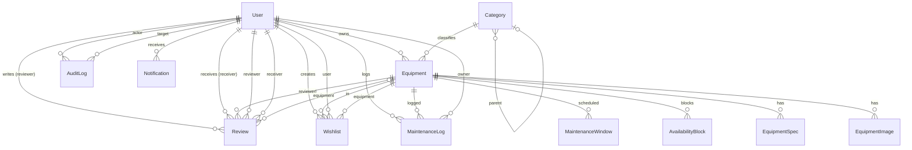

# RentalHub — Entity-Relationship Model

Source of truth: [`prisma/schema.prisma`](../prisma/schema.prisma).
Database: **SQLite** via Prisma. IDs are **CUIDs** (`@default(cuid())`).

## Conventions

### Timestamps
Models with user-facing mutability carry `createdAt DateTime @default(now())` and
`updatedAt DateTime @updatedAt`. Read-only children (e.g. `EquipmentImage`, `AuditLog`,
`AvailabilityBlock`, `MaintenanceWindow`) keep only `createdAt`. `MaintenanceLog` has both because
it can be edited (`PATCH /equipment/:id/maintenance/:logId`).

### Soft delete
`User`, `Category`, `Equipment`, `Review` carry a nullable `deletedAt DateTime?`. Deletion is a
soft delete — `DELETE` handlers set `deletedAt = now()` and every read path filters `deletedAt: null`.
A unique `@@index([deletedAt])` is declared where it matters (`User`, `Equipment`). Child rows
(`EquipmentImage`, `EquipmentSpec`, `AvailabilityBlock`, `MaintenanceLog`, `MaintenanceWindow`,
`Wishlist`, `Notification`, `AuditLog`) are **hard-deleted** via `onDelete: Cascade` (where a
relation is declared) or explicit `deleteMany`.

### Enums are Strings (SQLite has no native enums)
Every "enum" field is declared as `String` and validated at the API boundary with Zod. Values:

| Field                       | Allowed values                                                              |
| --------------------------- | --------------------------------------------------------------------------- |
| `User.role`                 | `customer` \| `owner` \| `admin` (default `customer`)                       |
| `User.accountType`          | `individual` \| `business` (owners only; nullable)                         |
| `Equipment.status`          | `draft` \| `active` \| `paused` \| `rejected` (default `draft`)             |
| `Equipment.condition`       | `new` \| `like_new` \| `good` \| `fair` \| `poor` (default `good`)           |
| `AvailabilityBlock.reason`  | `owner_blocked` \| `maintenance` \| `booked` (default `owner_blocked`)      |
| `Review.status`             | `published` \| `hidden` \| `flagged` (default `published`)                  |
| `pricingRules[].type`        | `weekend_surcharge` \| `long_discount` \| `seasonal`                        |
| `pricingRules[].unit`        | `percent` \| `amount`                                                        |

### Arrays / JSON
SQLite stores primitives in scalar columns. Arrays of objects are normalized as child models
(`EquipmentImage`, `EquipmentSpec`) **or** stored as a Prisma `Json?` field (`Equipment.pricingRules`,
`Review.images`, `Notification.data`, `AuditLog.metadata`). The choice is per-field:
- Normalized child models are used when the entries are first-class (images ordered, specs ordered).
- `Json` is used for free-form metadata and for the dynamic-pricing rule array (≤8 items, Zod-validated).

---

## Mermaid ER Diagram

---

## Models

### User
Principal account entity. RBAC role, owner business profile, password reset, suspension.

| Field                  | Type       | Notes                                                 |
| ---------------------- | ---------- | ----------------------------------------------------- |
| `id`                   | String  PK | CUID                                                  |
| `email`                | String  UQ | Lowercased on write                                    |
| `name`                 | String?    |                                                       |
| `passwordHash`         | String     | bcrypt (10 rounds); scrypt fallback if bcrypt absent   |
| `role`                 | String     | `customer` \| `owner` \| `admin` (default `customer`)  |
| `accountType`          | String?    | `individual` \| `business` (owners)                    |
| `businessName`         | String?    |                                                       |
| `registrationNumber`  | String?    |                                                       |
| `avatarUrl`            | String?    |                                                       |
| `avatarPublicId`       | String?    | local filename; Cloudinary public id in prod           |
| `phone`                | String?    |                                                       |
| `bio`                  | String?    |                                                       |
| `isVerified`           | Boolean     | admin-set badge (default false)                        |
| `isSuspended`          | Boolean     | default false; blocks login if true                    |
| `isOnboarded`          | Boolean     | set true on first profile PATCH                        |
| `resetToken`           | String?    |                                                       |
| `resetTokenExpiry`     | DateTime?   | 1h                                                    |
| `lastLoginAt`          | DateTime?   |                                                       |
| `createdAt`/`updatedAt`| DateTime    |                                                       |
| `deletedAt`            | DateTime?   | soft delete                                            |

Relations: `equipment[]`, `wishlists[]`, `reviewsGiven[]`, `reviewsReceived[]`,
`maintenanceLogs[]`, `auditLogsActor[]`, `auditLogsTarget[]`, `notifications[]`.

Indexes: `role`, `isSuspended`, `deletedAt`.

### Category
Lightweight taxonomy for equipment.

| Field         | Type       | Notes                          |
| ------------- | ---------- | ------------------------------ |
| `id`          | String  PK | CUID                           |
| `name`        | String  UQ |                                |
| `slug`        | String  UQ | kebab-case, Zod-validated       |
| `description` | String?    |                                |
| `iconUrl`     | String?    |                                |
| `parentId`    | String?    | self-FK (not enforced in DB)   |
| `createdAt`/`updatedAt` | DateTime |                  |
| `deletedAt`   | DateTime?   | soft delete                    |

Relations: `equipment[]`.

Indexes: `slug`, `parentId`.

### Equipment
Core listing entity.

| Field                | Type       | Notes                                                                |
| -------------------- | ---------- | -------------------------------------------------------------------- |
| `id`                 | String  PK | CUID                                                                 |
| `title`              | String     |                                                                      |
| `description`        | String     |                                                                      |
| `categoryId`  FK     | String     | → `Category.id`                                                       |
| `ownerId`  FK        | String     | → `User.id`                                                          |
| `status`             | String     | `draft` \| `active` \| `paused` \| `rejected` (default `draft`)       |
| `condition`          | String     | `new` \| `like_new` \| `good` \| `fair` \| `poor` (default `good`)    |
| `baseDailyPrice`     | Float      |                                                                      |
| `baseHourlyPrice`    | Float?     |                                                                      |
| `baseDeposit`        | Float      | default 0                                                            |
| `replacementValue`   | Float?     |                                                                      |
| `pricingRules`       | Json?      | array of pricing-rule objects (≤8, Zod-validated)                    |
| `lat`/`lng`          | Float?     | geo point (no native 2dsphere; distance via Haversine in JS)          |
| `city`               | String?    |                                                                      |
| `address`            | String?    |                                                                      |
| `bufferHours`         | Int        | default 0, range 0–72 (Zod)                                          |
| `purchaseDate`       | DateTime?  |                                                                      |
| `conditionNotes`     | String?    |                                                                      |
| `moderatedAt`        | DateTime?  |                                                                      |
| `moderatedById`      | String?    | (denormalized admin id; no FK constraint)                            |
| `createdAt`/`updatedAt` | DateTime |                                                              |
| `deletedAt`          | DateTime?   | soft delete                                                          |

Relations: `category`, `owner`, `images[]`, `specs[]`, `wishlists[]`, `reviews[]`,
`availabilityBlocks[]`, `maintenanceLogs[]`, `maintenanceWindows[]`.

Indexes: `categoryId`, `ownerId`, `status`, `baseDailyPrice`, `city`, `deletedAt`.

### EquipmentImage
Image attached to a listing (hard-deleted with the parent via `onDelete: Cascade`).

| Field         | Type       | Notes                                  |
| ------------- | ---------- | -------------------------------------- |
| `id`          | String  PK | CUID                                   |
| `equipmentId` FK | String   | → `Equipment.id` (Cascade)             |
| `url`         | String     | `/uploads/<file>` (local)               |
| `publicId`    | String?    | filename / Cloudinary id                |
| `isPrimary`   | Boolean    | default false; one-per-equipment enforced in app code |
| `order`       | Int        | default 0                              |
| `createdAt`   | DateTime   |                                        |

Indexes: `equipmentId`.

### EquipmentSpec
Key/value spec rows (ordered).

| Field         | Type       | Notes                        |
| ------------- | ---------- | ---------------------------- |
| `id`          | String  PK | CUID                         |
| `equipmentId` FK | String   | → `Equipment.id` (Cascade)   |
| `key`         | String     | max 60 (Zod)                 |
| `value`       | String     | max 120 (Zod)                |
| `order`       | Int        | default 0                    |

Indexes: `equipmentId`.

### AvailabilityBlock
A blocked/unavailable date range on a piece of equipment.

| Field         | Type       | Notes                                              |
| ------------- | ---------- | -------------------------------------------------- |
| `id`          | String  PK | CUID                                               |
| `equipmentId` FK | String   | → `Equipment.id` (Cascade)                         |
| `ownerId`     | String     | denormalized owner (no FK)                          |
| `startDate`   | DateTime   |                                                    |
| `endDate`     | DateTime   | must be > `startDate` (validated in handler)        |
| `reason`      | String?    | `owner_blocked` \| `maintenance` \| `booked`        |
| `createdAt`   | DateTime   |                                                    |

Indexes: `equipmentId`, `[startDate, endDate]`.

> Phase 2 will use these blocks (reason `booked`) as the availability engine's source of truth.

### MaintenanceLog
A record of past maintenance performed on equipment.

| Field         | Type       | Notes                                  |
| ------------- | ---------- | -------------------------------------- |
| `id`          | String  PK | CUID                                   |
| `equipmentId` FK | String   | → `Equipment.id` (Cascade)             |
| `ownerId`  FK | String     | → `User.id`                            |
| `title`       | String     | max 120 (Zod)                          |
| `description` | String?    |                                        |
| `cost`        | Float      | default 0                              |
| `performedAt` | DateTime   | default now (overridable in body)       |
| `createdAt`/`updatedAt` | DateTime |                                  |

Indexes: `equipmentId`, `ownerId`.

### MaintenanceWindow
A *scheduled* future maintenance window. Creating one also creates a matching
`AvailabilityBlock { reason: 'maintenance' }` (kept in sync by app code).

| Field         | Type       | Notes                                              |
| ------------- | ---------- | -------------------------------------------------- |
| `id`          | String  PK | CUID                                               |
| `equipmentId` FK | String   | → `Equipment.id` (Cascade)                         |
| `ownerId`     | String     | denormalized owner                                  |
| `startDate`   | DateTime   |                                                    |
| `endDate`     | DateTime   | must be > `startDate`                               |
| `notes`       | String?    |                                                    |
| `createdAt`   | DateTime   |                                                    |

Indexes: `equipmentId`, `[startDate, endDate]`.

### Wishlist
A user's saved equipment. Unique on `(userId, equipmentId)`.

| Field          | Type       | Notes                                              |
| -------------- | ---------- | -------------------------------------------------- |
| `id`           | String  PK | CUID                                               |
| `userId`  FK   | String     | → `User.id` (Cascade)                              |
| `equipmentId` FK | String   | → `Equipment.id` (Cascade)                         |
| `createdAt`    | DateTime   |                                                    |

Constraints: `@@unique([userId, equipmentId])`. Indexes: `userId`, `equipmentId`.

### Review
A rating (1–5) from a customer to an owner, optionally tied to an equipment.

| Field          | Type       | Notes                                              |
| -------------- | ---------- | -------------------------------------------------- |
| `id`           | String  PK | CUID                                               |
| `reviewerId` FK | String    | → `User.id` (`ReviewReviewer`)                     |
| `receiverId` FK | String    | → `User.id` (`ReviewReceiver`)                     |
| `equipmentId` FK | String?  | → `Equipment.id` (optional)                        |
| `rating`       | Int        | 1–5                                                |
| `title`        | String?    |                                                    |
| `body`         | String?    |                                                    |
| `images`       | Json?      | array of image URLs/metadata                        |
| `status`       | String     | `published` \| `hidden` \| `flagged` (default published) |
| `createdAt`/`updatedAt` | DateTime |                                            |
| `deletedAt`    | DateTime?  | soft delete                                         |

Indexes: `receiverId`, `equipmentId`, `reviewerId`, `status`.

### Notification
In-app notification to a user (Phase 2 driver; schema ready).

| Field       | Type       | Notes                              |
| ----------- | ---------- | ---------------------------------- |
| `id`        | String  PK | CUID                               |
| `userId` FK | String     | → `User.id` (Cascade)              |
| `type`      | String     |                                    |
| `title`     | String     |                                    |
| `message`   | String     |                                    |
| `data`      | Json?      |                                    |
| `isRead`    | Boolean    | default false                      |
| `createdAt` | DateTime   |                                    |

Indexes: `userId`, `isRead`.

### AuditLog
Append-only audit trail. Every sensitive admin/owner action writes a row (`src/lib/audit.ts`).

| Field         | Type       | Notes                                              |
| ------------- | ---------- | -------------------------------------------------- |
| `id`          | String  PK | CUID                                               |
| `actorId` FK  | String?    | → `User.id` (`AuditActor`); nullable for system actions |
| `targetId` FK | String?    | → `User.id` (`AuditTarget`); nullable              |
| `action`      | String     | e.g. `LISTING_APPROVED`, `USER_UPDATED_BY_ADMIN`    |
| `resource`    | String     | e.g. `user`, `equipment`, `category`, `system`    |
| `resourceId`  | String?    |                                                    |
| `metadata`    | Json?      | free-form diff                                     |
| `ip`          | String?    |                                                    |
| `createdAt`   | DateTime   |                                                    |

Indexes: `actorId`, `action`, `[resource, resourceId]`, `createdAt`.

---

## Index Strategy (summary)

Indexed fields are chosen for the hot query paths:

- **Auth/admin**: `User.role`, `User.isSuspended`, `User.deletedAt`.
- **Marketplace search**: `Equipment.status`, `Equipment.city`, `Equipment.baseDailyPrice`,
  `Equipment.categoryId`, `Equipment.deletedAt`.
- **Owner dashboards**: `Equipment.ownerId`.
- **Time-series**: `AvailabilityBlock.[startDate, endDate]`, `MaintenanceWindow.[startDate, endDate]`,
  `AuditLog.createdAt`.
- **Lookup-by-parent**: `EquipmentImage.equipmentId`, `EquipmentSpec.equipmentId`,
  `Review.equipmentId`/`receiverId`/`reviewerId`, `Wishlist.userId`/`equipmentId`.
- **Uniqueness**: `User.email`, `Category.name`, `Category.slug`, `Wishlist.(userId, equipmentId)`.

> Note: SQLite has no native geo or full-text index types. Keyword search uses Prisma `contains`
> (compiled to SQL `LIKE '%q%'`); distance filtering uses the Haversine formula computed in JS
> after a candidate fetch. Both are documented as Phase-1 limitations in DECISIONS.md.
